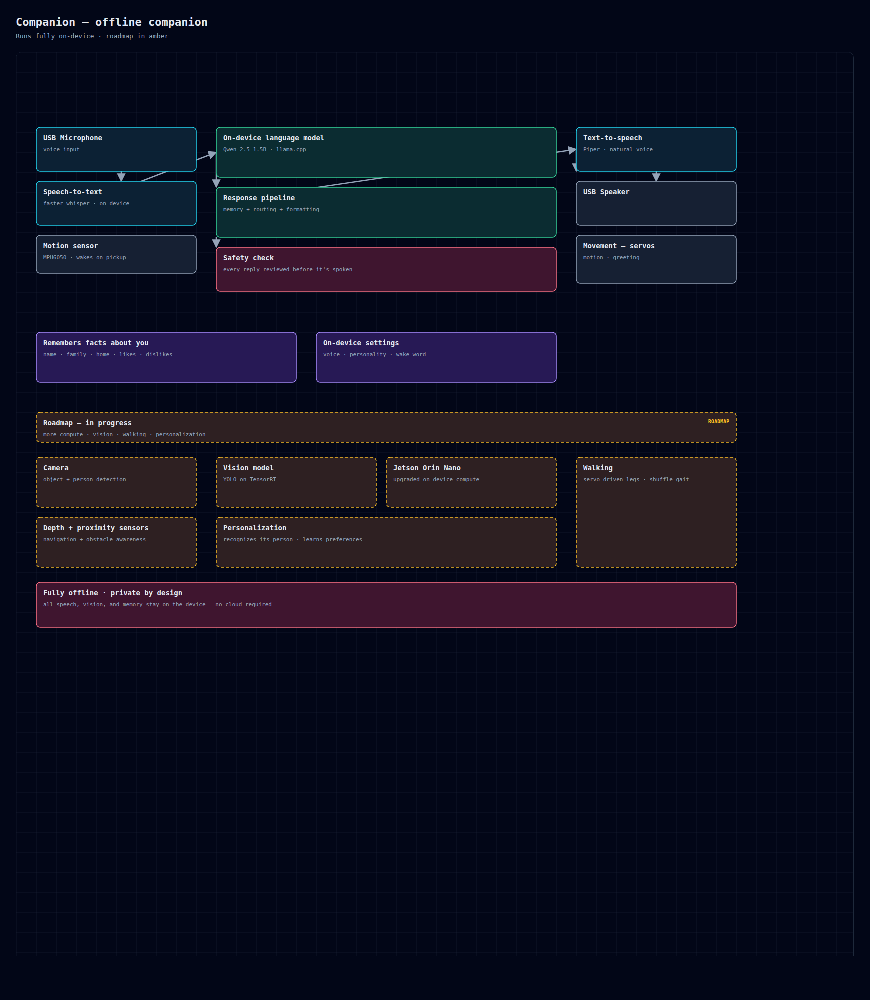

# Companion

An offline, on-device AI pet. It listens, generates a reply, checks it, and
speaks — entirely on local hardware, with no network connection.

Website: [offline.pet](https://offline.pet)

## Pipeline

The runtime runs a four-stage loop on-device:

1. **Speech recognition** — a local model transcribes microphone audio to text.
2. **Generation** — a small local language model writes a reply.
3. **Safety check** — every generated line is reviewed on-device before it is
   spoken; a line that fails is replaced with a safe fallback.
4. **Speech synthesis** — a local text-to-speech model renders the reply.

## Input handling

- **Wake word** — the device responds only when addressed by name; it ignores
  background speech and strips the name from the reply.
- **Voice activity detection** — non-speech audio is filtered before
  transcription, reducing false transcriptions in noisy environments.
- **Resampling** — microphone input is resampled to the model rate at
  44.1 kHz, 48 kHz, and 16 kHz.

## Memory

Structured, bounded fields: name, family, home, likes, dislikes. Values are
validated before they are stored.

## Hardware

- Raspberry Pi 5 (8 GB)
- USB microphone
- USB speaker
- Fully offline — no Wi-Fi, no cloud, no subscription

## Privacy

Speech is processed locally and never uploaded. Owner data stays on the device
and can be cleared at any time.

## Roadmap

v1 runs on a Raspberry Pi 5. v2 is the same companion on a Jetson Orin Nano:
more onboard compute for a larger model, vision, and movement.

- **v2 hardware:** Jetson Orin Nano. The four-stage loop (listen, generate,
  check, speak) moves over with headroom to spare.
- **Vision:** an onboard camera, so it sees what it is looking at.
- **Movement:** four legs, walking fully on-device.
- **Safety hardening:** I am strengthening the safety layer. The rule set
  is expanding, and I test it against reworded, obfuscated, and near-miss
  phrasing, scored on a set it was not trained on.
- **Learning:** the learning path stays human-guided. The language model
  ships unmodified and out-of-the-box; what improves is a separate judgment
  layer fed by consented feedback.
- **V3 dock:** a charging dock that is also the one place optional, consented
  data can leave the device, closing the learning loop.

## Status

v1 runs offline. The safety layer and on-device models are under active
development — see `RESULTS.md` for what is verified.
