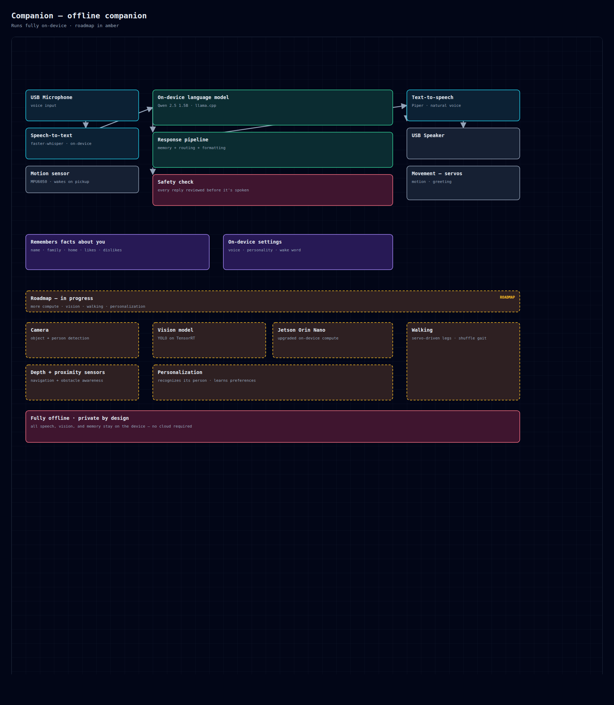

# Companion

An offline, on-device AI pet. It listens, generates a reply, checks it, and
speaks — entirely on local hardware, with no network connection.

Website: [offline.pet](https://offline.pet)

## Pipeline

The runtime runs a four-stage loop on-device:

1. **Speech recognition** — a local model transcribes microphone audio to text.
2. **Generation** — a small local language model writes a reply.
3. **Safety check** — every generated line is reviewed on-device before it is
   spoken; a line that fails is replaced with a safe fallback.
4. **Speech synthesis** — a local text-to-speech model renders the reply.

## Input handling

- **Wake word** — the device responds only when addressed by name; it ignores
  background speech and strips the name from the reply.
- **Voice activity detection** — non-speech audio is filtered before
  transcription, reducing false transcriptions in noisy environments.
- **Resampling** — microphone input is resampled to the model rate at
  44.1 kHz, 48 kHz, and 16 kHz.

## Memory

Structured, bounded fields: name, family, home, likes, dislikes. Values are
validated before they are stored.

## Hardware

- Raspberry Pi 5 (8 GB)
- USB microphone
- USB speaker
- Fully offline — no Wi-Fi, no cloud, no subscription

## Privacy

Speech is processed locally and never uploaded. Owner data stays on the device
and can be cleared at any time.

## Status

v1 runs offline. The safety layer and on-device models are under active
development — see `RESULTS.md` for what is verified.
